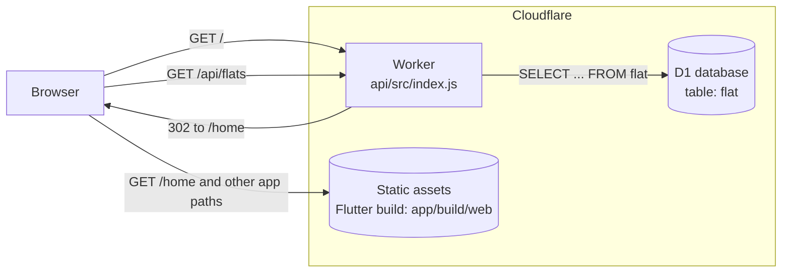
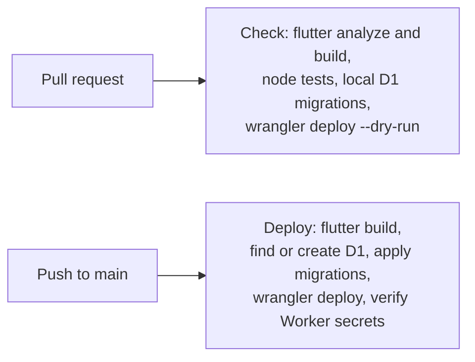

# find-a-flat

## Architecture

Find a flat runs as a single Cloudflare Worker. The same Worker serves the
Flutter web app as static assets and answers a small JSON API backed by a D1
(SQLite) database.

| Path | Handled by | What it does |
| --- | --- | --- |
| `/` | Worker | Redirects to `/home` |
| `/home` (and any other app path) | Static assets | Serves the Flutter app (`index.html` fallback), which routes itself |
| `/api/flats` | Worker | Returns the rows of the `flat` table as JSON |

### Repository layout

| Folder | Contents |
| --- | --- |
| `app/` | Flutter web app (Flutter 3.47.9) |
| `api/` | Worker code, `wrangler.toml`, D1 migrations, Node tests |
| `.github/workflows/` | `check.yml` on every pull request, `deploy.yml` on every push to `main` |

### CI/CD

Deploy needs two GitHub secrets, `CLOUDFLARE_API_TOKEN` and
`CLOUDFLARE_ACCOUNT_ID`. The Worker secret `WRITE_PASSPHRASE` will be needed once the app can add or edit flats.
